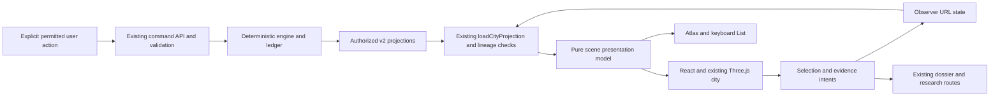

# StarNet-inspired Manyworld UI redesign

Date: 2026-10-28. Updated: 2026-10-29. Status: **recommended direction accepted;
first district preview implemented on the feature branch**.
Tracking: [MW-33](https://alinojoumi8.atlassian.net/browse/MW-33), under MW-6.
Branch: `codex/starnet-ui-redesign`, created from current/upstream main
`ed20ff4395581a5b4257d3fbd6b7cc971f97c318`. Existing local edits are preserved.

## Recommendation

Build an original, interactive Manyworld city using our existing React shell,
observer projections and experimental Three.js city. Take StarNet's strongest
interaction ideas: a world that fills the workspace, selectable characters and
places, contextual inspection, and visible activity tied to evidence. Start with
one polished district and one complete inspection journey before redesigning
the rest of the application.

Use StarNet as a design and engineering reference. Do not import its whole
frontend or runtime. Selected MIT utility code could be adapted later if a
bounded spike proves it saves work; no third-party source or assets are imported
by this plan. Preserve Atlas and List as supported alternatives.

The working visual direction is a **living civic district**: original buildings,
distinct citizens, readable signage, and compact instruments. It combines the
spatial clarity of a game with Manyworld's evidence and history. This is the
direction selected by the user on 2026-10-29. Its first opt-in implementation is
documented in [DESIGN.md](../../DESIGN.md#interactive-district-preview).
An original pixel-art station remains an alternative, outside this first slice.

## What was actually inspected

- Manyworld source and existing documentation at the commit above; the codebase
  graph located the integration points, followed by their source. `graft` was
  unavailable and no `graft/INDEX.md` was found. `docs/lessons.md` does not exist
  in this checkout.
- All 38 open MW issues returned by the required JQL; pagination was exhausted.
  MW-33 already covers City/Price Lab workflow acceptance, so it is reused.
  Its prerequisite MW-32 is still To Do. Preparatory design work is In Progress;
  its researcher-acceptance checkboxes remain unverified.
- [StarNet](https://github.com/androoAGI/starnet), pinned to
  [`ab5fa2c981cd8529ee8fe17a4c93f4ef78068a49`](https://github.com/androoAGI/starnet/tree/ab5fa2c981cd8529ee8fe17a4c93f4ef78068a49),
  on the upstream `feat/harness-backend` branch. This is a source snapshot, not
  a claim about a released desktop binary.
- StarNet's [published station replay](https://starnetos.com/#station) in a
  browser. That page explicitly labels its footage as scripted harness-event
  replay with no running model. Visual inspection is not a live-runtime test.
- Manyworld's rendered Atlas and experimental 3D at 1440 × 1000, using the
  existing `installCityFixture` with 24 citizens and 12 places. All `/api/`
  requests were intercepted and WebSocket events were synthetic. The fixture
  intentionally lacks some workspace/bookmark/provider endpoints, which yielded
  404s and unavailable panels. These captures show composition, not a complete
  backend acceptance result. No saved scientific database was opened.

ECC's frontend-design-direction and architecture-decision-records guidance
informed the comparison. The user subsequently selected the recommended approach;
this document remains the implementation plan, without a separate ADR.

## First implementation slice — 2026-10-29

The existing **3D · experimental** choice (`view=3d`) now opens the district
preview. Atlas remains the default; switching views preserves selection. This
slice refreshes Manyworld's existing original Blender assets and Three.js scene;
it imports no StarNet assets, code, packages or runtime.

- The city and one shared evidence inspector occupy separate columns on desktop.
  Below 1050px the inspector follows the scene, with a button that moves keyboard
  focus to the selected evidence. Recorded activity follows the scene/inspector.
- Native selectable landmark labels share the same URL selection as geometry
  picking and the keyboard explorer. At most ten non-overlapping labels appear;
  selected identities take priority. Dense or offscreen entities remain in the
  explorer and List. Labels are presentation, not extra simulation records.
- Camera overview fits projected geometry bounds to the viewport. Pan, rotation,
  zoom, follow, Back/Forward and existing camera bookmarks remain supported.
- The scene uses a lighter civic ground/street palette. Existing app light/dark
  preferences continue to control the surrounding UI. Signal colors retain their
  outcome meanings; the selected activity heading is readable in both themes.
- Coherent projection loading, history, missing-coordinate display slots,
  privacy/capability states, WebGL fallback and evidence routes remain the existing
  contracts. Selection does not issue mutation requests.

Validation and remaining gates are recorded in
[the district preview verification](2026-10-29-district-preview-verification.md).
This is the first implementation increment, not completion of the full redesign
or MW-33's seven-step City/Price Lab research acceptance. Later phases still need
the broader interaction study, measured performance budget and adoption decision.

## What we already have

Manyworld is not starting from a blank dashboard. Its current City already
supports Atlas, List, experimental 3D, capability-gated recorded-day playback,
selection, following, camera bookmarks, an evidence lens, contextual workspaces,
and a complete-day activity feed.

| Existing seam | Current responsibility | Proposed use |
| --- | --- | --- |
| [WorldWorkspace.tsx](../../dashboard/src/workspaces/WorldWorkspace.tsx), lines 36–137 | Composes City, activity, panels, live status and runtime telemetry | Keep this orchestration and improve the composition around it |
| [cityProjection.js](../../dashboard/src/app/cityProjection.js), lines 21–47 | Loads map first, pins the other projections to its tick and checks lineage | Keep it as the authoritative frontend data entry point |
| [observerViewState.ts](../../dashboard/src/app/observerViewState.ts), lines 11–116 | URL state for run context, selection, filters, follow and cameras | Reuse; preserve Back/Forward, reload and deep links |
| [CivicCity.jsx](../../dashboard/src/components/CivicCity.jsx), lines 133–1206 | Shared City selection, display modes and evidence lens | Evolve in small slices; avoid adding another large combined component |
| [CityViewport.tsx](../../dashboard/src/city/CityViewport.tsx), lines 12–132 | Three.js lifecycle, picking, camera, preview and fallback | Prototype the new spatial presentation here, behind a preview opt-in |
| [cityProjectionCore.js](../../dashboard/src/city/cityProjectionCore.js), lines 34–122 | Maps projected entities into render instances and activity | Extend only for presentation needs; do not calculate economic truth here |
| [WorldOSApp.tsx](../../dashboard/src/app/WorldOSApp.tsx), lines 34–66 | Existing People, organizations, markets, conversations, evidence and research routes | Reuse routes and contextual panels rather than duplicate their features |

The actual observer type includes `view=3d`. `view=diorama` is retained for
older bookmarks; it is not the current experimental Three.js selector. The
first prototype should extend the existing `3d` path, not introduce a fourth
public renderer without a demonstrated need.

The baseline review suggests three presentation opportunities: make the city
feel like recognizable places, put selection details in one calmer inspector,
and reduce the amount of navigation and activity competing with the scene.
The inspected fixture also demonstrates that a simple row of 3D buildings is
not sufficient on its own: composition, camera framing and interaction matter.

## What transfers from StarNet

StarNet's frontend is vanilla JavaScript loaded through ordered scripts. Its
station is part of a complete agent harness with its own state, persistence,
tools, permissions, provider connections and local Node sidecar. It is not a
React component library or a generic economy visualization package.

At the pinned revision, `frontend/app/world.js` has 12,776 lines;
`worldmodel.js` 5,134; `stationbake.js` 5,782; `build.js` 9,963;
and `app.js` 6,208. These are measured source counts, not cost estimates.
`world.js:648–677` resets station, crew, cargo, layout and subscription state;
its tick loop at `6688–6861` calls movement and social helpers. Extracting only
the drawing code would still require separating those assumptions.

| StarNet idea | Manyworld adaptation | Boundary |
| --- | --- | --- |
| Station as the main workspace | A district with selectable citizens, firms, banks and civic places | Scene remains a projection of Manyworld state |
| Agent selection and contextual information | A citizen dossier with activity, employer and evidence links | Show only fields available in the authorized projection |
| Work visible at a location | Recorded employment, presence and completed events highlighted at the relevant public place | A job is not proof of current physical presence |
| Visible workflows and handoffs | Optional overlays for recorded communications, trade and construction events | No decorative conveyor implies a transaction or delegated task |
| Contextual tools | Actions offered for the selected entity when the existing backend permits them | Selection and dragging never grant authority |
| Motion pacing and cached scenery | Render on demand, cache static geometry, pause unnecessary work when hidden | Do not copy decorative wandering into historical evidence |
| Detailed operational panels | Reuse Manyworld's evidence, people and research panels | Keep provider telemetry separate from committed simulation outcomes |

The product semantics differ. In StarNet, rooms and placed objects can grant
capabilities to real tool-running agents. In Manyworld, institutions and
construction have economic and governance rules. A visual floor plan cannot
become a permission model or bypass the deterministic ledger.

## Reuse options

| Option | Benefit | Main cost or risk | Recommendation |
| --- | --- | --- | --- |
| A. Original Manyworld presentation on existing React/Three | Reuses working data, routing, selection, research and fallback paths; own art direction | Requires focused visual design and asset work | **Choose this for the first prototype** |
| B. Extract selected MIT frontend code | May save work on a genuinely independent camera/cache/helper module | Globals, boot order, cleanup and station assumptions must be removed; maintain notices and a pinned upstream manifest | Conditional, after a small isolation spike |
| C. Embed StarNet in an iframe | Quick reference demonstration | Separate origin/state/focus, auth and history; still needs an adapter, new art and removal of harness controls | Reference-only experiment, not the product integration |
| D. Fork the full StarNet UI/runtime | Maximum similarity to the upstream station experience | Two sources of authority; extensive removal of providers, tools, saves and capability logic; ongoing fork maintenance | Poor fit for this redesign |

No new PixiJS, Phaser, Tauri or game-engine dependency is required for option A.
If exact 2D pixel art becomes the selected direction, first compare one small
Canvas2D renderer with the current Three.js view using the same projection and
original assets. Make that renderer choice after visual and performance evidence.

## Licensing and asset policy

The upstream [LICENSE](https://github.com/androoAGI/starnet/blob/ab5fa2c981cd8529ee8fe17a4c93f4ef78068a49/LICENSE)
permits MIT code reuse with its copyright and permission notice.
The [README licensing section](https://github.com/androoAGI/starnet#license)
and [NOTICE.md](https://github.com/androoAGI/starnet/blob/ab5fa2c981cd8529ee8fe17a4c93f4ef78068a49/NOTICE.md#starnets-own-name-and-artwork)
expressly exclude StarNet's own name, logo, station artwork, sprites and brand
identity from that grant. The implementation plan therefore uses original
Manyworld art. Do not copy sprite sheets, station textures, logos or a baked
station image into our product. Inspect the specific terms of any separate
third-party asset or font rather than treating the repository license as blanket
permission.

For any later code extraction: record upstream commit, path, source lines,
license, local modifications and test coverage in an attribution manifest;
preserve required notices in the distributed bundle. Import the smallest useful
module only after proving it works without StarNet globals, network calls,
storage, provider setup or runtime execution. Avoid the upstream station-art
generation code in the first slice as well as its static assets.

## Proposed experience

Purpose: help a researcher understand who is doing what, where a recorded
change occurred, and which evidence supports it. The primary action is
**select an entity and inspect its recorded activity**.

Use the existing civic typography and signal meanings as a starting point,
with original, readable building silhouettes and citizens. Support the current
light/dark theme conventions. Use text and shape alongside color. A dense
technical display does not need StarNet's CRT treatment on small text.

```text
Manyworld   Run / fork / day   Find citizen or place       Live state
------------------------------------------------------------------
City / Atlas / List   Layers                  Simulation controls
------------------------------------------------------------------
                                      | Selected citizen or place
  Interactive civic district          | Role / observed location
  pan · zoom · select · follow         | Recorded activity
                                      | Open dossier / evidence
                                      | Contextual permitted actions
------------------------------------------------------------------
Selected-day events → choose an event → highlight entity + evidence
Observation day / recorded playback controls (separate from Run/Step)
```

The [standalone clickable concept](2026-10-28-starnet-ui-concept.html) illustrates layout, entity selection,
layer switching, evidence inspection and changing an example observation day.
It uses invented sample content and original SVG geometry, makes no API calls,
and cannot advance a simulation. It is a composition proposal, not the approved
art direction, a production implementation, or a measure of renderer performance.

Core journeys:

1. Select a citizen in the scene or keyboard explorer. The same URL selection
   drives the inspector. Follow keeps that person selected across frames;
   missing public positions pause following and explain why.
2. Select a firm, bank or public place. Inspect its actual projected state,
   recorded events and available dossier/price-lab links. No-trade periods and
   unavailable values remain explicit; a missing price is never generated.
3. Select a completed, pending or rejected event. Highlight only referenced
   entities, then open its evidence at the same run/fork/tick. Back restores
   selection, camera, filters and day.
4. Inspect a historical day. Hide live telemetry and mutation controls.
   Recorded-day playback only animates supported recorded presence and has its
   own clock. Scrubbing never changes simulation speed or advances the world.
5. Open People, Economy, Markets or research tools from the selected context.
   Keep the existing routes and the working City beneath the panel.

Deferred: free-form building placement, room-based capabilities, agent-to-agent
workflow editing, chat/task delegation, economy mechanics, desktop packaging,
and a full replacement of every research workspace. These need separate
behavior contracts and are not implied by a visual redesign.

## Technical boundary



- Preserve `run_id`, `fork_id`, tick, `snapshot_version`, `view_key`,
  `policy_version`, `semantics_version`, projection version and evidence IDs.
  Feed the renderer one coherent frame. Cancel/discard responses for old scope;
  reject mixed-tick, mixed-visibility or mixed-lineage payloads.
- Build a small, pure presentation adapter only if the new art needs one:
  render key, public label, entity reference, geometry, provenance and recorded
  activity references. Reuse `projectCity` where sufficient. Do not add a second
  fetcher, event store or economic model inside the renderer.
- Keep recorded coordinates, derived display positions and private/aggregated
  locations distinct. Never turn district-level private housing into precise
  home addresses. Label illustrative roads and buildings.
- Historical ticks show historical projections. Live provider activity is
  ephemeral and may pulse only when it matches the current run/fork; it does
  not establish that an economic action succeeded.
- Pure presentation changes require no database migration or semantics bump.
  If a design needs new state, first audit the existing projections. Add any
  necessary observer contract separately; version any actual simulation change.
- A renderer may emit selection, camera and navigation intents. It cannot call
  providers, move balances, persist world state or submit commands implicitly.
  Existing authorized command controls remain a separate, deliberate path.
- Mount/unmount cleanly: dispose GPU resources and handlers, stop timers, and
  cancel subscriptions on run change. Preserve the existing WebGL/lazy-load
  fallback. An iframe or a copied global script bundle is not this boundary.

## Content, accessibility and performance contract

| State | Visible result | Safe next action |
| --- | --- | --- |
| Loading | Stable scene frame and progress text; no fabricated activity | Wait or cancel navigation |
| Empty | Explain no entities vs no filter matches | Clear filters or choose an available run |
| Error | Explain which projection failed; keep scope visible | Retry the same scope or use Atlas/List |
| Partial | Available entities plus explicit missing capabilities/fields | Inspect available evidence; no inferred substitute |
| Success | Selection, event outcome and evidence agree at one committed tick | Open the dossier or evidence |
| Permission | Explain that this role cannot access a field/action | Return to the public view or existing consent workflow |
| Stale/disconnected | Last available tick and connection state; frozen activity | Reconnect or retry; no live mutation from stale state |
| Historical | Prominent day/fork context; no live telemetry or world controls | Scrub supported history or return to Live |

Target viewports: 390 × 844, 768 × 1024 and 1440 × 1000. Desktop gives the
scene most of the working area and keeps one inspector. On smaller screens,
selection details move below the scene or into a deliberate sheet; controls
remain reachable without shrinking the city into a thumbnail. Provide a real
HTML entity explorer, visible focus, semantic names, Escape/back behavior,
44-pixel touch targets, color-independent outcomes and reduced-motion behavior.
Never make canvas interaction the only way to complete a task.

Proposed budgets, to be measured rather than assumed: at 300 visible agents and
100 places on a recorded reference desktop, p95 frame time at or below 33 ms
while navigating, and selection feedback within 100 ms after data is present.
Record browser, viewport, hardware, draw calls, memory and sample duration.
At larger populations, cluster/cull and show the representation boundary.
Do not animate all citizens or add continuous GPU work to a paused world.
Background tabs should suspend rendering and use the existing data policy.
These are prototype targets, not measured performance claims.

## Delivery sequence and exit criteria

| Phase | Work | Exit criterion |
| --- | --- | --- |
| 0 — decision package (this branch) | Pin sources, compare reuse, inspect baseline, prepare a clickable composition and record risks | User can select native city vs original pixel station and review the first slice |
| 1 — original visual slice | One small district using our assets; citizen, firm, bank, public place; selection and one inspector; reuse existing `view=3d` in an opt-in preview | Click and keyboard selection work at all three viewports; original art provenance recorded; Atlas/List still work |
| 2 — real projection integration | Reuse coherent map/activity loader, scope changes, URL selection, following, evidence links, historical state and fallback | Fixture tests cover valid, invalid, delayed and mixed-lineage frames; no additional write requests during observation |
| 3 — complete investigation journey | Selected citizen → employer → prices or event → evidence → Back; refine recorded-day playback and visible outcomes | The journey retains run/fork/tick/camera through Back/Forward and reload; privacy and capability states verified |
| 4 — validation and adoption | Bounded performance tests, accessible mobile/desktop review, real provider-free disposable-world acceptance, CodeRabbit and CI | Approved candidate meets the gates; only then propose making it the default |

Phase 1 is the recommended next implementation request. It should not include
the station editor, new command semantics or a full workspace rewrite. Estimate
delivery dates after the art direction and reference hardware are chosen;
the major uncertainties are asset work, dense-scene behavior and historical
projection completeness, not React bootstrapping.

Implementation changes will likely touch `WorldWorkspace`, `CivicCity`,
`CityViewport`/`CityScene`, scoped city styling and narrowly scoped renderer
helpers. Update DESIGN and the city-observer guide when behavior is accepted,
not by describing this proposal as already shipped. Preserve existing URLs,
old renderers and the production static bundle until the new view is verified.

## Verification for the implementation

Use the existing city fixtures and route tests first; do not replay user runs
to test presentation. Add tests for observable contracts, not styling internals:
selection parity, stale response rejection, tick/visibility mismatch, hidden
private locations, historical/live separation, fallback and disposal.

Required frontend checks:

```bash
pnpm --dir dashboard test
pnpm --dir dashboard typecheck
pnpm --dir dashboard run licenses:check
pnpm --dir dashboard exec playwright test world-os.spec.ts world-os-states.spec.ts world-os-privacy.spec.ts agent-connections.spec.ts world-os-routes.spec.ts live-city-context.spec.ts city-unified.spec.ts city-viewport.spec.ts
pnpm --dir clients/typescript typecheck
pnpm --dir clients/typescript build
```

There is no configured dashboard lint script or root package.json. Keep the
existing lockfile; do not introduce a pnpm lockfile as part of the redesign.
For verification before intentional UI changes, build into a fresh temporary
directory. When frontend changes are intentionally shipped, review and commit
the corresponding `server/static/` bundle under the repository workflow.

Also run the compilation, dataset verification, full Python suite, `pip check`,
dependency audits, diff hygiene and applicable CI gates from
[development.md](../development.md#test-layers). Check the pnpm audit prerequisite
explicitly; the repository currently has a package-lock rather than a pnpm
lockfile. Do not relabel an unavailable audit as passed.

For the final integration, run the existing provider-free real-backend City
research acceptance against its disposable fixture under its resource bounds.
Record viewport artifacts, keyboard/reduced-motion/fallback evidence, and
measured researcher-task results. Follow ECC's evidence-record/checker workflow
for the implementation; a passing record validates completeness of the record,
not product truth. Full MW-33 acceptance still depends on MW-32 and covers
goods and equities, evidence and exports; a polished City screenshot cannot
complete that issue or MW-35.

Rollback is selecting the supported Atlas/List or existing city presentation;
the preview stays opt-in until accepted. No economic migration, source-run
rewrite or desktop-harness installation is part of the proposed rollout.

## Planning verification and limitations

Branch creation and upstream identity were verified. Reference source, notices,
data seams and both rendered City modes were inspected. The clickable concept
was checked at all three target viewports, including keyboard selection, list
mode, evidence expansion, day changes, layer toggles, zoom and all six preview
content states. A layer-toggle defect in the standalone SVG concept was fixed
and retested. ECC's evidence-record checker passed; this is concept evidence,
not application integration acceptance.

Local verification on 2026-10-28:

| Check | Result |
| --- | --- |
| Documentation contract | 22 passed |
| Required backend smoke selection | 170 passed |
| Dashboard unit suite | 289 passed |
| Dashboard typecheck and temporary-output build | Passed; committed `server/static/` unchanged |
| Python compilation, dataset checks and `pip check` | Passed |
| Plan local links and diff hygiene | Passed |
| Full Python suite | Incomplete: terminated at the 240-second bound; no full pass claimed |
| Critical Chromium suite (145 selected tests) | Incomplete: terminated at the 240-second bound; no full pass claimed |
| Dashboard third-party notices | Failed: existing notice file is stale |
| TypeScript client typecheck/build | Unavailable: client dependencies/`tsc` are missing |
| Python dependency audit | Failed: audit flagged pinned `certifi==2026.6.17` |
| pnpm dashboard audit | Unavailable: no `pnpm-lock.yaml`; existing lockfile was preserved |
| Dashboard lint | Not configured |
| Hosted CI / CodeRabbit PR review | Not run: this is a local planning branch without a PR |

The audit/tooling failures are outside the documentation and concept changes.
No dependency fixes, notice regeneration or lockfile migration were made.
The local test environment uses Node 24.21.0 and Python 3.11.15; it is not the
complete CI platform matrix. Commands, logs, screenshots and bounded-run results
are retained with this task's local evidence. No application implementation,
real-provider test, saved-run diagnostic, production deployment, push or pull
request is implied.

## Source references

- [StarNet README and architecture](https://github.com/androoAGI/starnet/tree/ab5fa2c981cd8529ee8fe17a4c93f4ef78068a49#architecture).
- [StarNet world module](https://github.com/androoAGI/starnet/blob/ab5fa2c981cd8529ee8fe17a4c93f4ef78068a49/frontend/app/world.js#L648-L677)
  and [script boot order](https://github.com/androoAGI/starnet/blob/ab5fa2c981cd8529ee8fe17a4c93f4ef78068a49/frontend/index.html#L822-L865).
- [Manyworld City observer contract](../research/city-observer.md),
  [Price Lab](../research/price-lab.md), [design system](../../DESIGN.md),
  [City navigation plan](2026-09-07-city-workspace-navigation.md), and
  [research acceptance contract](2026-09-07-city-research-acceptance.md).
